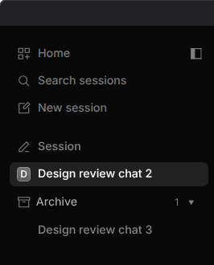
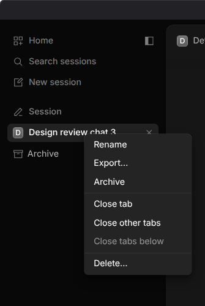

# Chat Archive for OpenCode Desktop

An unofficial patch that adds chat archiving to OpenCode Desktop 2.3.2.

Archived chats leave the active session lists and move into a collapsible **Archive** fold
in the left sidebar. They can be opened from the fold and restored with **Unarchive** from
the same right-click menu.

## Features

- A collapsible **Archive** fold in the left sidebar, alongside the open chats.
- **Archive** in the right-click menu for:
  - open session tabs,
  - project session rows,
  - Home's recent-session rows.
- Archiving a chat closes any open tab for it and removes it from the active lists.
- Archived chats remain available from the Archive fold and open normally when selected.
- Archived chats show **Unarchive** in their right-click menu.
- The fold lists archived sessions across every connected server.
- Fold state is remembered locally.
- The fold is available in the vertical list, project, customizable, recent, and inbox
  sidebar layouts.

## Screenshots

### Archive fold



### Archive in the chat menu



## How it works

The patch touches the renderer of OpenCode Desktop 2.3.2:

| Path | Change |
|---|---|
| `packages/app/src/session/commands/archive-session.ts` | archive/unarchive through the existing session API, cache refresh, tab cleanup |
| `packages/app/src/shell/titlebar/archive-sessions.tsx` | collapsible Archive fold, archived-session query, open/restore rows |
| `packages/app/src/shell/titlebar/tab-nav.tsx` | Archive/Unarchive item for open session tabs |
| `packages/app/src/shell/titlebar/project-session-row.tsx` | Archive/Unarchive item for project session rows |
| `packages/app/src/home/sessions/view.tsx` | Archive item in Home's session context menu |
| `packages/app/src/home/sessions/controller.tsx` | enables the Home archive action through the real session API |
| `packages/app/src/shell/titlebar/tab-strip.tsx` | mounts the fold under vertical tabs |
| `packages/app/src/shell/titlebar/recent-sessions.tsx` | mounts the fold in the Recent layout |
| `packages/app/src/shell/titlebar/inbox.tsx` | mounts the fold in the Inbox layout |

Archiving uses the server's existing `PATCH /api/session/:sessionID` endpoint with
`{ archived: true }`. Unarchiving sends `{ archived: false }`. The patch does not add a new
server endpoint or a new network destination.

The Archive fold uses the same authenticated local server connection as the rest of the
desktop app. It requests the newest archived root sessions with
`session.list({ archived: true, parentID: null, order: "desc" })` and refreshes them when
the server emits archive, unarchive, or delete events.

## Install

Tested against OpenCode Desktop **2.3.2**. Apply the patch to the matching source and
build the desktop app:

```bash
curl -L -o opencode.tar.gz \
  https://codeload.github.com/anomalyco/opencode/tar.gz/refs/tags/v2.3.2
mkdir opencode && tar xzf opencode.tar.gz -C opencode --strip-components=1
cd opencode

git apply /path/to/archive.patch
bun install --frozen-lockfile
OPENCODE_CHANNEL=prod OPENCODE_VERSION=2.3.2 bun run --cwd packages/desktop build
```

### Installing into an existing packaged app

The desktop app loads its renderer from `resources/app.asar`. This patch changes only
renderer files, so it can be applied without a full repackage:

1. Back up `resources/app.asar`.
2. Extract the existing asar.
3. Replace `out/renderer` with the `packages/desktop/out/renderer` produced by the build.
4. Repack the directory with `@electron/asar` and replace `resources/app.asar`.
5. Restart the app.

A published application update replaces `app.asar` and removes the customization, so
reapply the patch after an update.

## Safety and privacy

- The patch contains no API keys, tokens, passwords, credentials, or local configuration.
- It adds no telemetry and no new analytics.
- It makes no new external network requests. Archiving goes through the desktop app's
  existing authenticated local server.
- Archived session metadata stays on the same local OpenCode server as the rest of the
  session history. Archiving does not upload chat contents anywhere.
- Session titles are still rendered as text; the patch adds no HTML injection or code
  evaluation.
- The patch was reviewed for absolute paths, secrets, and environment-specific values
  before publication.

## Compatibility

This is a patch, not a fork. It is pinned to OpenCode Desktop 2.3.2 because it changes
renderer internals. A later upstream release may need the patch adapted.

## License

MIT. See [LICENSE](LICENSE).

OpenCode is © opencode and contributors and is licensed under the MIT License. This
project is unofficial and is not affiliated with OpenCode. The upstream license is
included in [LICENSE-OPENCODE](LICENSE-OPENCODE); see also [NOTICE](NOTICE).
